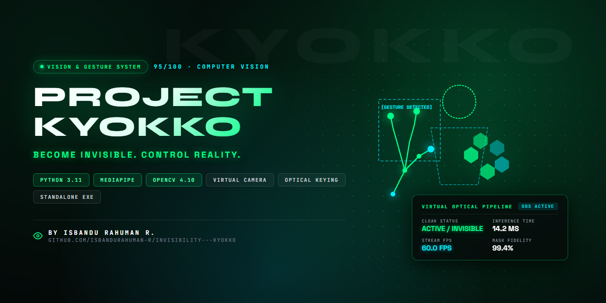

<p align="center">
  
</p>

# PROJECT KYOKKO ✦
### Gesture-Controlled Invisibility Virtual Camera for Windows


-purple?style=flat-square)


**KYOKKO** is a Windows desktop application that enables users to become **completely invisible** in their webcam feed through an intuitive **hand-to-head gesture**. 

When you touch your temple, forehead, or ear with your hand, your entire body dissolves seamlessly into your captured empty-room background. When your hand moves away, your body smoothly reappears without stutter or frame freezing.

The application broadcasts its video stream directly to **Google Meet, Zoom, Discord, Microsoft Teams**, and any software that supports Windows DirectShow virtual cameras.

---

## Key Highlights

- **Gesture-Controlled Invisibility:** Real-time 3D hand tracking, head landmark localization, and normalized distance calculation.
- **Advanced Invisibility Engine:** Multi-frame temporal background capture, MediaPipe neural selfie segmentation, morphological edge dilation, Gaussian feathering, and exponential moving average smoothing.
- **Cinematic Alpha Dissolve:** Smooth cross-fade transition factor prevents abrupt cuts or pixel tearing.
- **DirectShow Virtual Camera:** Streams directly to Zoom, Google Meet, Microsoft Teams, and Discord via `pyvirtualcam` and OBS Virtual Camera DirectShow filter.
- **Premium Obsidian & Purple UI:** Hardware-accelerated PySide6 interface designed with obsidian black (`#08060f`), electric purple (`#9d4edd`), and cyan neon accents.
- **100% Local & Private:** All computer vision inference and video streams process locally on your machine with zero cloud connectivity.
- **SQLite Configuration Store:** Settings, camera profiles, background calibrations, and activity logs persist across sessions.
- **Standalone Windows Executable:** Runs as a standalone `.exe` without requiring Python or command-line setup.

---

## System Architecture

```
KYOKKO/
├── main.py                     # Application entrypoint
├── requirements.txt            # Pinned production dependencies
├── build_exe.py                # Automated PyInstaller build script
├── kyokko.spec                 # PyInstaller packaging configuration
├── install_obs_virtual_camera.bat # 1-click batch installer for DirectShow driver
├── README.md                   # Complete documentation
│
├── database/                   # SQLite persistence layer
│   ├── db_manager.py           # Thread-safe database connection manager
│   └── models.py               # Settings, CameraProfile, BackgroundProfile models
│
├── core/                       # Real-time processing orchestration
│   ├── pipeline.py             # 60 FPS decoupled vision worker thread
│   ├── worker.py               # Asynchronous workers & calibration countdown
│   └── events.py               # PySide6 signal bridge
│
├── vision/                     # MediaPipe neural vision subsystem
│   ├── hand_detection.py       # 21 3D landmarks & fingertip keypoints
│   ├── head_detection.py       # Face bounding box & head touch target zones
│   ├── person_segmentation.py  # Full-body neural segmentation mask
│   └── gesture_recognition.py  # Hand-to-head distance, hysteresis & state machine
│
├── invisibility/               # Invisibility compositing subsystem
│   ├── background_capture.py   # Multi-frame denoised clean background capture
│   ├── mask_processing.py      # Dilation, morphological closing & feathering
│   ├── background_restoration.py # Alpha dissolve blending & illumination match
│   └── invisibility_engine.py  # Coordinator for person replacement
│
├── camera/                     # Camera input & virtual output
│   ├── camera_manager.py       # OpenCV DirectShow capture & auto-reconnect
│   └── virtual_camera.py       # pyvirtualcam DirectShow broadcasting
│
├── effects/                    # Real-time grading
│   └── image_effects.py        # Brightness, contrast, blur, sharpen, color filters
│
├── ui/                         # PySide6 desktop interface
│   ├── main_window.py          # Master window with sidebar & stacked views
│   ├── components/             # Reusable widgets (VideoView, StatCard, GestureMeter, Toast)
│   ├── pages/                  # 8 Studio pages (Dashboard, Camera, Gesture, Background, Effects, Devices, Settings, About)
│   └── themes/                 # Obsidian purple QSS stylesheets
│
├── services/                   # Configuration & logging services
│   ├── config_service.py       # In-memory cached configuration
│   └── logger_service.py       # Centralized rotating file & SQLite logger
│
├── utils/                      # System telemetry & format utilities
│   ├── image_utils.py          # OpenCV to QImage conversions & letterboxing
│   └── system_info.py          # Webcam discovery & DirectShow backend checks
│
└── tests/                      # Comprehensive unit test suites
    ├── test_database.py        # Database CRUD & models test
    ├── test_vision.py          # Hand/head detection & gesture logic test
    ├── test_invisibility.py    # Mask refinement & background blending test
    └── test_camera.py          # Device enumeration & diagnostics test
```

---

## Quick Start

### Option A: Standalone Windows Executable (No Python Required)
1. Run `dist\KYOKKO\KYOKKO.exe`.
2. (Optional) Run `install_obs_virtual_camera.bat` if you have not previously installed the OBS Virtual Camera DirectShow driver.

### Option B: Running from Source
```powershell
# Clone or navigate to the directory
cd d:\KYOKKO

# Create Python 3.11 or 3.12 virtual environment
py -3.12 -m venv venv
.\venv\Scripts\activate

# Install dependencies
pip install -r requirements.txt

# Run KYOKKO
python main.py
```

---

## How Invisibility Works

1. **Step 1: Background Calibration**
   - Click **Quick Calibration (3s)** on the Dashboard.
   - Step out of camera view for 3 seconds.
   - KYOKKO captures multiple consecutive frames and applies a temporal median filter to create a clean, noise-free image of your background.

2. **Step 2: Start Virtual Camera**
   - Click **Start Virtual Camera**.
   - KYOKKO connects to the Windows DirectShow virtual camera interface (`OBS Virtual Camera`).

3. **Step 3: Connect to your Meeting App**
   - In **Zoom, Google Meet, Microsoft Teams, or Discord**, navigate to your Video Settings.
   - Change your camera from your physical webcam to **OBS Virtual Camera**.

4. **Step 4: Execute the Invisibility Gesture**
   - Raise your hand and touch your temple, forehead, or ear.
   - When the normalized hand-to-head distance falls below the trigger threshold and is held for the activation delay (default 200 ms), the invisibility engine activates.
   - Your body dissolves seamlessly into the calibrated background.

5. **Step 5: Reappear**
   - Move your hand away from your head.
   - After the release delay (default 150 ms), the alpha blender restores your live webcam feed smoothly.

---

## Gesture Control Settings

| Parameter | Recommended | Range | Description |
|---|---|---|---|
| **Hand Preference** | `Both` | Left, Right, Both | Restrict gesture detection to a specific hand or allow either. |
| **Touch Sensitivity** | `0.45` | `0.20 - 0.80` | Normalized distance threshold relative to head size. |
| **Activation Delay** | `200 ms` | `50 - 1000 ms` | Duration hand must touch head to confirm activation. |
| **Release Delay** | `150 ms` | `50 - 800 ms` | Duration hand must be away before restoring visibility. |
| **Cooldown** | `500 ms` | `100 - 2000 ms` | Anti-jitter lockout duration between state flips. |

### False-Positive Rejection
KYOKKO prevents accidental triggers from common hand movements:
- **Vertical Elevation Guard:** Hands below neck or chest level are rejected even if they are in horizontal proximity.
- **Hysteresis Timing:** Quick passes of the hand near the face do not activate invisibility unless held for the full activation duration.

---

## Video Effects & Visual Grading

In the **Effects** tab, you can customize your live broadcast:
- **Brightness & Contrast:** Hardware-accelerated exposure compensation.
- **Saturation:** Color vibrance control via HSV color space.
- **Gaussian Blur & Sharpening:** Depth-of-field simulation or crisp edge enhancement.
- **Cinematic Color Presets:**
  - *Normal* - Natural true-to-life color reproduction.
  - *Cyberpunk* - Electric blue shadows with magenta highlights.
  - *Matrix* - Classic terminal phosphor green tone.
  - *Cinema Cool* - Hollywood teal & orange blockbuster color grade.
  - *Sepia* - Warm vintage nostalgic tone.
  - *Noir* - High-contrast monochromatic black & white.
  - *Warm Sunset* - Golden hour warm ambient glow.
- **Mirror Mode:** Flip feed horizontally for natural mirror interaction.

---

## DirectShow Virtual Camera Compatibility

KYOKKO output is compatible with:
- **Zoom** (Video Settings > Camera > OBS Virtual Camera)
- **Google Meet** (Settings > Video > Camera > OBS Virtual Camera)
- **Microsoft Teams** (Settings > Devices > Camera > OBS Virtual Camera)
- **Discord** (User Settings > Voice & Video > Video Settings > Camera > OBS Virtual Camera)
- **OBS Studio / Streamlabs** (Video Capture Device > OBS Virtual Camera)

---

## Running Unit Tests

To run the complete test suite:
```powershell
.\venv\Scripts\python.exe -m unittest discover tests
```
All 13 test cases across database persistence, MediaPipe vision detection, gesture recognition state machine, invisibility mask processing, and camera management run in under 3 seconds.

---

## Standalone Compilation

To recompile the standalone Windows executable:
```powershell
.\venv\Scripts\python.exe build_exe.py
```
Output executable will be placed in: `dist\KYOKKO\KYOKKO.exe`.

---

## License & Privacy

KYOKKO is built for private, offline, high-fidelity video production. No camera frames or neural inference outputs are ever recorded without user consent or transmitted over any network.
